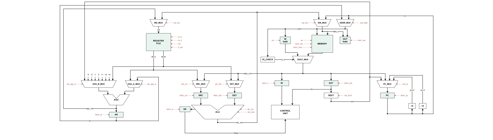
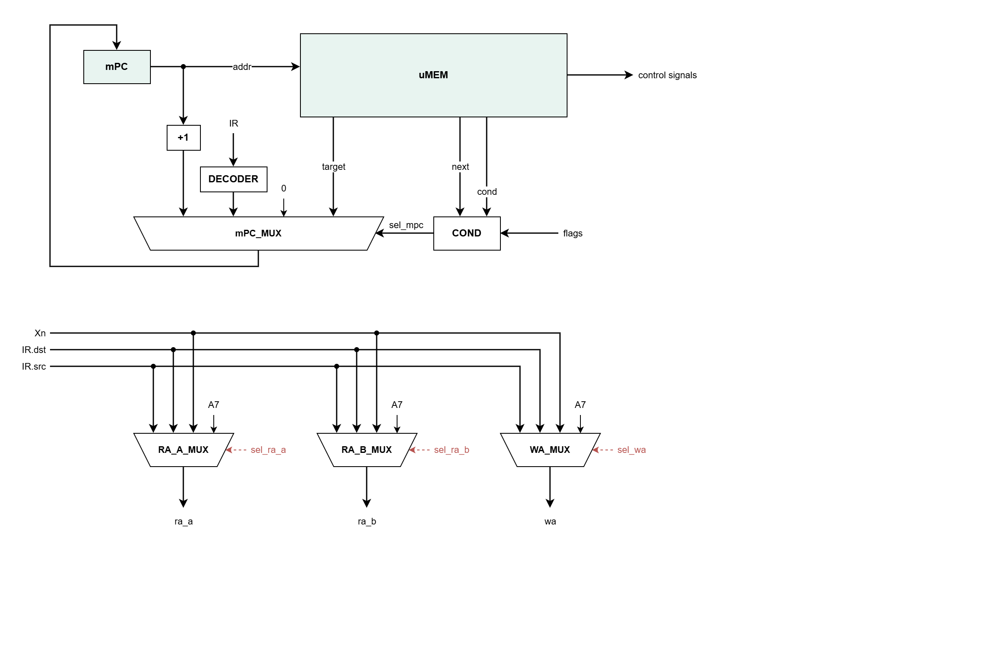

# csa-lab3-schematic

**Author:** Tserendorj Ariunbat  
**Year:** 2026  
**Variant:** m68k-neumann-microcode

- [DataPath (png)](DataPath/m68k-schematic-DataPath.png)
- [Control Unit (png)](CU/m68k-schematic-CU.png)
- [DataPath (svg)](DataPath/m68k-schematic-DataPath.svg)
- [Control Unit (svg)](CU/m68k-schematic-CU.drawio.svg)
- [Source (draw.io)](m68k-schematic.drawio)

## Copyright and Usage Restrictions

Copyright (c) 2026 Tserendorj Ariunbat. All rights reserved.

This repository is published for academic evaluation purposes only.

Anyone who copies or misuses this work is solely responsible for the consequences.